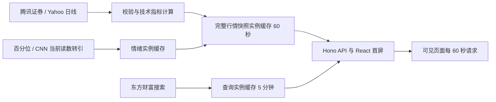

# trendbeak 数据链路与可靠性

## 实际链路

浏览器请求的是同源 API。页面隐藏时跳过；恢复可见时请求；已有请求进行中时避免叠加。选中个股时还会更新对应大盘对照。服务端没有行情 Cron，缓存过期后由下一次访问触发抓取。

## 缓存和持久化

- 行情：按市场和标的，实例内 Map 60 秒；相同键的并发请求合并，成功结果才缓存。实例回收后消失，不跨实例共享。
- 情绪：A 股成功结果 1 小时，美股成功结果 5 分钟，失败空值 60 秒。
- 搜索：成功结果 5 分钟，输入等待 180 毫秒后发起请求。
- 行情接口响应声明浏览器缓存 15 秒、共享缓存 60 秒；搜索声明 60/300 秒；首页声明共享缓存 60 秒。缓存头不等于行情新鲜度承诺。
- 日线、盘中快照和分时均未写入本应用数据库或文件。快照包含历史日历与指标，不只是当天一行。
- 本站不采集分钟线或逐笔。腾讯请求 `day`，Yahoo 请求 `interval=1d`；盘中值来自正在更新的当日日线柱。
- 浏览器 localStorage 保存最近 10 条搜索；离线缓存仅保存静态图标、离线页等，不保存行情 API 数据。

## 历史覆盖与预热

价格请求保留既有来源：腾讯最多 640 条前复权日线；Yahoo 两年日线。响应历史窗口扩展为 730 自然日，保留上游真实价格，供年度内较早日期的 365 日趋势使用。技术指标仍逐日用截至该日的前缀计算，避免未来数据进入历史值。

RSI 需要至少 15 个交易日；MA20 至少 20 个交易日；量能比需要当前完整日及此前 20 个完整日；52 周位置需要完整自然年覆盖。新股、停牌和源数据不足仍可能留空。

2026-10-29 核验的原正式版本：美股四项各有 250 个交易日，A 股四项各有 242 个交易日，仅当日盘中量能比为空。旧产品中缺失的全年曲线主要是情绪源只有一个观测，以及返回历史被截为一年的范围限制，不能笼统解释为技术指标没有数据。

美股情绪来源目前只提供带日期的当前读数及未逐日标注的比较值。CNN 官方历史入口正常请求返回 418 拒绝访问；未重试伪装请求或接入未核验镜像。全年缺口保留为空。365 自然日通常只有约 250 个交易日，不补成 365 个情绪点。

## 可靠性边界

- 行情和搜索上游请求超时为 8 秒；美股依次尝试 Yahoo 两个域名。A 股与搜索没有备用源，也没有指数退避重试。
- 情绪请求超时为 4 秒。失败时返回明确空值，不用技术指标替代情绪。
- 浏览器刷新失败会保留上次成功读数并提示失败；首次加载失败则显示不可用。Worker 没有在刷新失败后返回过期快照的兜底。
- 没有源站请求限流器、跨实例去重或持久化行情备份。公开数据接口没有本站可承诺的 SLA；不将“偶尔 200”作为可靠性证明。
- 已知但未查明根因：此前 A 股首次加载不可用；生产搜索曾返回 503，后续同请求也曾返回 200。本轮不声称已修复这些间歇故障。

实现入口：`src/App.tsx`、`src/server/market-data.ts`、`src/server/sentiment-data.ts`、`src/lib/market-signals.ts` 与 `public/service-worker.js`。
