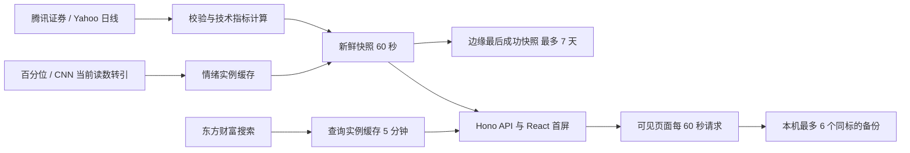

# trendbeak 数据链路与可靠性

## 实际链路

浏览器请求的是同源 API。页面隐藏时跳过；恢复可见时请求；已有请求进行中时避免叠加。选中个股时还会更新对应大盘对照。服务端没有行情 Cron，缓存过期后由下一次访问触发抓取。

## 缓存和持久化

- 行情：新鲜缓存与最后成功快照分开，按 schema 版本、市场、规范化标的隔离。新鲜期 60 秒；过期先尝试获取，失败才回退，最长 7 天（原始 fetchedAt 和首次成功 storedAt 均必须在期限内）。仅成功且完整校验的数据写入；失败、缓存读取和连续回退均不改时间或延长有效期。异常、损坏、错标的、旧版本、未来时间及过龄记录忽略。
- 服务端：实例内新鲜 Map 与 last-good Map 各最多 64 项，同实例相同键合并在途请求，失败冷却 15 秒；Cloudflare Cache API 内部响应物理保留 7 天。其不依赖进程 Map，可供同机房冷实例读取，但会被驱逐、不会跨机房复制，跨实例也没有 singleflight 或原子 CAS。写前重读较新记录可降低旧请求晚完成覆盖的风险，不能消除竞态。
- 正式的 trendbeak.com 与 trendbeak.pages.dev 使用同一规范化键；预览主机使用独立域名空间。相同键不代表不同机房或缓存作用域必然共享。
- 浏览器：localStorage 按 LRU 最多保留 6 个、序列化后 UTF-16 估算总量不超过 2 MiB 的完整、校验通过的同标的成功快照，刷新首屏缺失或同标的获取失败时回退，并始终标记“暂未更新 · 最近更新”。失败切换可保留原标的视图并明确原名称，不能拼接新名称与旧价格；如果目标已有独立备份则一起切换其名称、价格和历史。缓存禁用/损坏/超限不阻断在线数据。搜索历史仍最多 10 条。
- 情绪：A 股成功结果 1 小时，美股成功结果 5 分钟，失败空值 60 秒。此轮不改变来源和算法。
- 搜索：成功结果 5 分钟，输入等待 180 毫秒后发起请求。
- 行情/首页 HTTP 成功响应 no-cache，避免外层缓存遮蔽恢复；缺失和 503 为 no-store。内部 Cache API 的 7 天 TTL 不暴露为浏览器缓存期。搜索仍为 60/300 秒。
- 快照 freshness 包含 state、storedAt、ageSeconds、freshTtlSeconds、maxAgeSeconds 和 via。fetchedAt 是原行情抓取开始时间，storedAt 是完成成功快照校验的时间，asOf 是行情交易日期（没有据此伪称分时报价时间）；休市/收盘不以跨天单独判失败。旧盘中数据标作“盘中快照”，不冒充正在更新。健康接口对可展示但 stale 的数据报告 degraded，同时 available=true。
- 没有新建 KV/D1、采集 Cron 或行情归档；旧报告 D1 未修改。日线、盘中快照和分时均未写入应用数据库或文件。Cache API 和浏览器本机备份是可驱逐缓存，非完整行情数据库。
- 本站不采集分钟线或逐笔。腾讯请求 day，Yahoo 请求 interval=1d；盘中值来自正在更新的当日日线柱。Service Worker 仍不缓存页面导航或行情 API。

## 历史覆盖与预热

价格请求保留既有来源：腾讯最多 640 条前复权日线；Yahoo 两年日线。响应历史窗口扩展为 730 自然日，保留上游真实价格，保留可用的历史上下文。当前趋势图由唯一的起止日期窗口控制，双端可自由调整、整段平移和轨道跳转；历史可视边界来自真实大盘日线并集并裁切至最近365自然日；轨道与选区均不超过该范围，起止日期在条下两端，无快捷按钮。顶部热力日历与两市趋势共享同一窗口；桌面初次365日、移动初次90日。选日不改窗口；数据刷新、resize及同标签页reload保留显式历史范围。技术指标仍逐日用截至该日的前缀计算，避免未来数据进入历史值。

RSI 需要至少 15 个交易日；MA20 至少 20 个交易日；量能比需要当前完整日及此前 20 个完整日；52 周位置需要完整自然年覆盖。新股、停牌和源数据不足仍可能留空。

2026-10-29 核验的原正式版本：美股四项各有 250 个交易日，A 股四项各有 242 个交易日，仅当日盘中量能比为空。旧产品中缺失的全年曲线主要是情绪源只有一个观测，以及返回历史被截为一年的范围限制，不能笼统解释为技术指标没有数据。

美股情绪来源目前只提供带日期的当前读数及未逐日标注的比较值。CNN 官方历史入口正常请求返回 418 拒绝访问；未重试伪装请求或接入未核验镜像。全年缺口保留为空。365 自然日通常只有约 250 个交易日，不补成 365 个情绪点。

## 可靠性边界

- 行情和搜索上游请求超时为 8 秒；美股对可回退的错误依次尝试 Yahoo 两个域名；403/418/429、Retry-After 和完整超时不再尝试第二域名。A 股对耗时不足 2 秒的网络/5xx 暂时失败，等待 500 毫秒后最多再请求一次；完整超时、访问拒绝、429、Retry-After 以及 JSON/数据校验失败不走该快速重试。搜索没有引入重试或备用源。
- 情绪请求超时为 4 秒。失败时返回明确空值，不用技术指标替代情绪。
- 浏览器刷新失败会保留上次成功读数并提示失败；可识别为暂时请求故障的空首屏在 1.5 秒后只恢复一次，手动请求会取代该恢复；服务端已用过重试预算的失败不再触发首屏快速恢复，避免两层连续放大；访问拒绝、限流和数据校验失败不会触发这次快速恢复。持续失败优先返回明确标旧且未过 7 天的最后成功快照；没有合法快照才显示不可用。
- 部分市场失败的首页与双市场响应使用 no-store，不将不可用状态作为正常行情共享缓存；成功的行情/首页响应改为 no-cache。服务端仅记录有界错误阶段、状态和耗时，不记录查询词、headers 或响应正文。
- 没有跨机房持久化行情数据库、分布式锁或跨实例去重。首次从未成功、边缘被驱逐且浏览器无备份、备份过龄等情况下仍可能不可用。公开数据接口没有本站可承诺的 SLA；不将“偶尔 200”作为可靠性证明。
- 2026-10-29 07:19:58 UTC 的生产日志捕获腾讯行情上游 HTTP 501（首次尝试 586 毫秒），同一请求经有限重试最终 200，总耗时 2018 毫秒。这证实了一类上游临时错误及该次恢复，不是所有历史 503 的根因证明。此前 654 毫秒的 A 股 503 没有保留原始上游原因；搜索间歇 503 仍未定位，不能将二者混为一因或宣称已有 SLA。

实现入口：`src/App.tsx`、`src/server/market-data.ts`、`src/server/snapshot-cache.ts`、`src/lib/snapshot-record.ts`、`src/lib/browser-snapshots.ts`、`src/server/sentiment-data.ts`、`src/lib/market-signals.ts` 与 `public/service-worker.js`。

## 图表交互与来源边界

趋势图下读数只按日期查真实观测，周末/休市与缺失分开显示，不取相邻日替代。雷达呈现RSI14、EMA20/EMA60趋势差、布林(20,2)带宽、RVOL20，轴旁保持原单位，图外临时说明给出绘图刻度和观测日期。RSI原0～100；其余用之前最多252个有效完整观测的经验中位秩（小于数+相等数/2）/样本数×100，不包含当前观测，至少60个，平值序列的50来自真实并列秩，缺历史不补50。EMA60从前60收盘价SMA初始化后按2/61递推，EMA20同理；带宽使用20个收盘价总体标准差；RVOL分母排除分子日，盘中回到最近完整日且不跳过缺量日。CN继续采用腾讯qfqday优先、US沿用Yahoo quote.close，四维与既有RSI使用同一价序列，不混入adjclose或其他标的；指数仅用其上游报告的同标的量，缺失或零量不补ETF。所有历史计算只见截至当日的前缀。EMA历史中位不代表多空零线，原始正负保留；波动与量能不是买卖方向。无权重和综合分，不改变独立的CN/US贪恐来源。新雷达字段可选且版本化，旧快照仍能兜底行情和RSI，但不会被解释成新指标；浏览器仍受2MiB和最多6份约束，较大快照可能更早逐出。D3 MonotoneX 仅用于显示经过真实点且不产生额外峰值的曲线，交易日缺口仍断开，不生成历史观测。

交互只借鉴通用十字线、图例开关和缩略范围选择理念，没有复制参考站代码、UI 或调用其内部接口。[百分位方法说明](https://baifenwei.com/methodology/)未披露六项分值的完整公式与归一化窗口；[使用条款](https://baifenwei.com/terms/)要求商业用途书面许可。既有 A 股综合情绪来源沿用不变，其商业再使用许可尚未核验；本轮未增加第三方镜像依赖或扩大数据采集。

## 情绪与行情日期的展示

趋势末端显示窗口内最新真实观测；选日和图下临时读数精确匹配当日，不在头部添加重复摘要。情绪观测的存在性不再依赖同日价格日线：例如美股价格截至10月28日，而情绪源已有10月29日观测，不能据此把情绪误标为暂无数据。`parseUSSentiment` 仍按原始时间戳转换纽约日期；未改变来源、评分或时区算法，也不把最新值回填到历史日期。

缓存约束按 [Cloudflare Cache API 官方文档](https://developers.cloudflare.com/workers/runtime-apis/cache/)：不靠 stale-if-error / stale-while-revalidate 指令自动回退，物理保留期与业务新鲜期由代码明确分离。

情绪请求失败时，进程中已验证的过去观测会保留；同日未刷新的观测不作为当前值返回，错误状态仍记录在接口中。这是已有历史的失败保护，不是新建历史库，也不补造美国全年情绪。2026-10-30只读核验：现转引接口有当前reading和无日期比较值；CNN历史请求返回418，来源受限。

技术公式参考：[EMA](https://www.tradingview.com/support/solutions/43000592270-exponential-moving-average/)、[Bollinger BandWidth](https://www.tradingview.com/support/solutions/43000501972-bollinger-bandwidth-bbw/)、[Relative Volume](https://www.tradingview.com/support/solutions/43000635874-how-do-we-calculate-relative-volume-and-relative-volume-at-time/)。本产品选择20日量能基准，TradingView示例为10日；不宣称与其默认值完全相同。分位归一化是本产品绘图定义，不是新增情绪算法。

US后续本地修正：转引成功刷新及现有边缘快照冷实例刷新保留已有、可追溯的过去日期，不再只剩最后一条；无日期比较不作为前日观测，新直接CNN读取器因正常请求418而未启用。具体证据与适配边界见 [cnn-history-adapter.md](cnn-history-adapter.md)。
